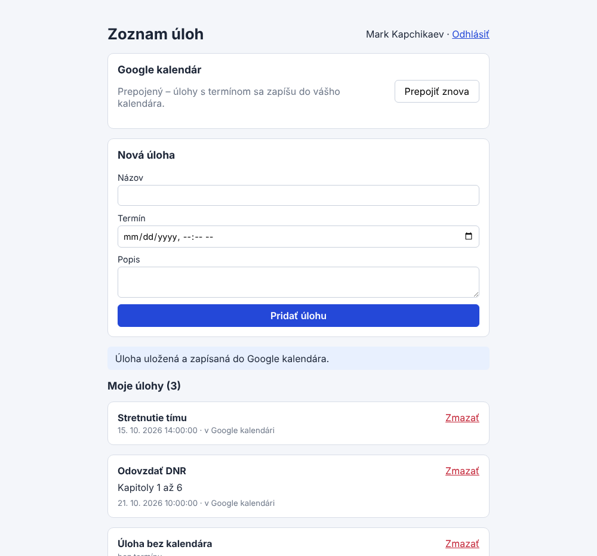
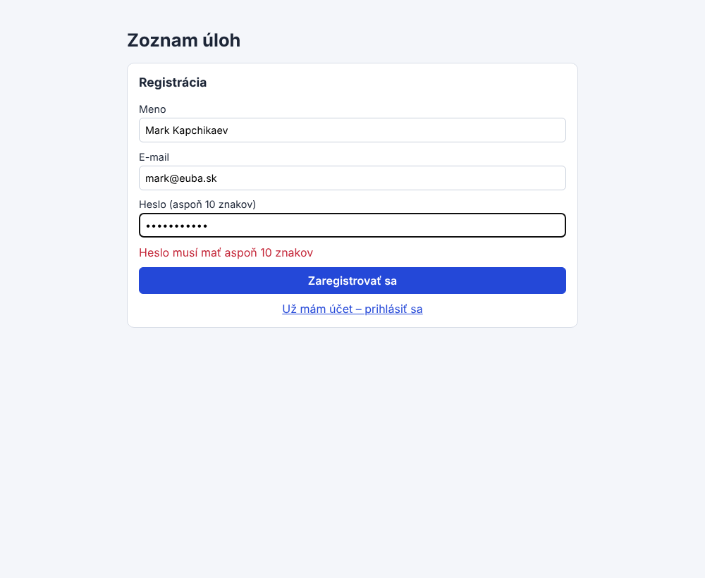
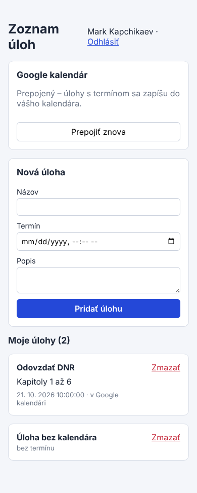
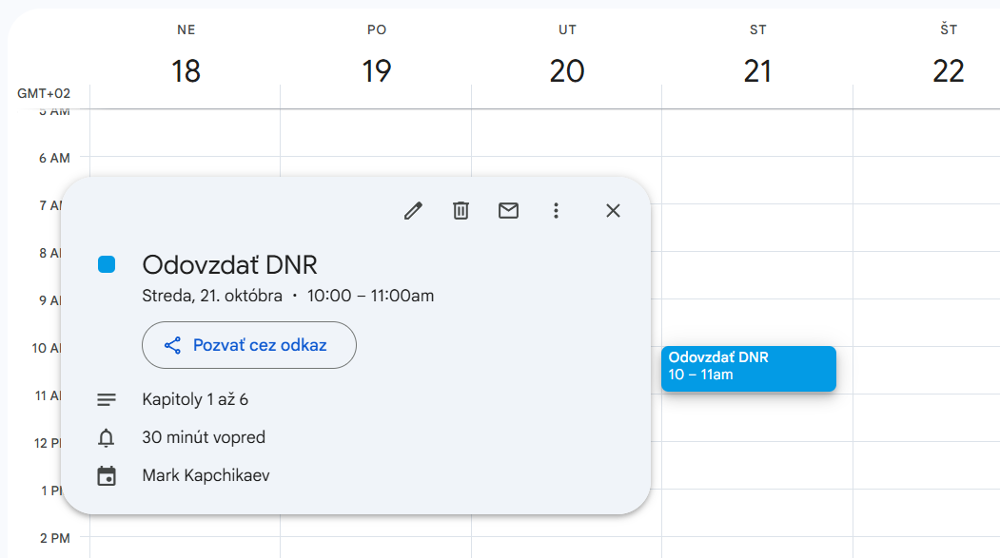
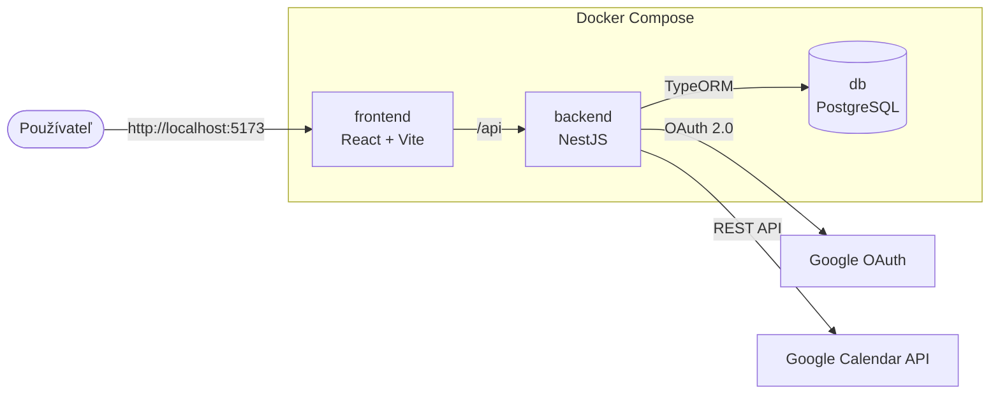
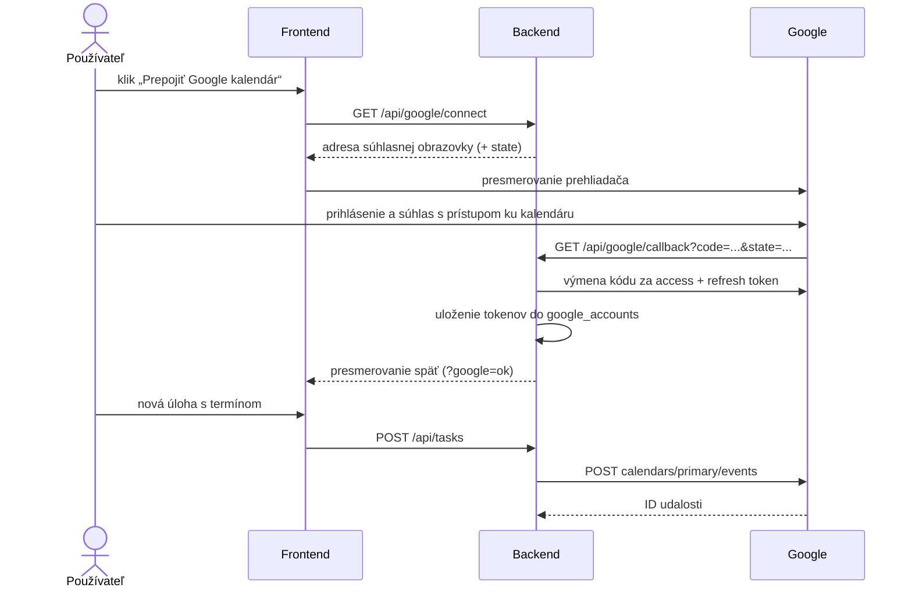
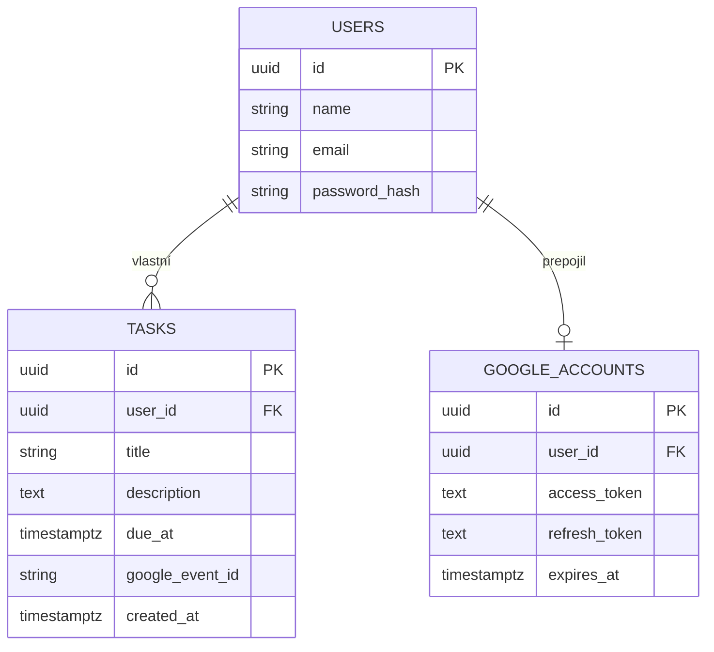

# Zoznam úloh – prototyp s Google Calendar

Prototyp webovej aplikácie na správu úloh, ktorá po prepojení s **Google Calendar** cez **OAuth 2.0** zapisuje úlohy s termínom priamo do kalendára používateľa.


<p align="center">
  
</p>

Projekt vznikol v predmete **Softvérové inžinierstvo I** na Ekonomickej univerzite v Bratislave (zadanie B – *Aplikácia Zoznam úloh*). Prototyp overuje najrizikovejšiu časť návrhu: prepojenie s externým kalendárom (požiadavky S.18 a E.05 v dokumente *Detailný návrh riešenia*).

## Funkcie

- registrácia a prihlásenie (heslo uložené ako bcrypt hash, prihlásenie cez JWT),
- vytvorenie úlohy s názvom, termínom a popisom – uloží sa do PostgreSQL,
- prepojenie s Google kalendárom jedným súhlasom (OAuth 2.0),
- úloha s termínom sa automaticky zapíše do kalendára ako udalosť,
- zmazanie úlohy odstráni aj udalosť v kalendári,
- automatické obnovenie prístupového tokenu cez refresh token.

## Ukážka

| Registrácia | Úlohy a Google kalendár | Mobilný telefón |
|:---:|:---:|:---:|
|  |  |  |

Úloha „Odovzdať DNR“ s termínom 21. 10. 10:00 vytvorená v aplikácii a automaticky zapísaná do Google kalendára:

<p align="center">
  
</p>

## Rýchle spustenie

Potrebný je iba [Docker Desktop](https://www.docker.com/products/docker-desktop/).

```bash
git clone https://github.com/TheXName/zoznam-uloh-prototyp.git
cd zoznam-uloh-prototyp
docker compose up
```

Keď sa vo výpise objaví `Backend beží na http://localhost:3000/api`, otvorte **http://localhost:5173**.

- Prvé spustenie trvá niekoľko minút (sťahujú sa obrazy a inštalujú balíčky). Ďalšie spustenia inštaláciu preskočia, kým sa nezmení `package-lock.json`.
- Zastavenie: `Ctrl + C`. Vymazanie všetkého aj s databázou: `docker compose down -v`.
- Balíčky sa inštalujú aj do priečinkov projektu, takže VS Code rozpozná importy bez inštalácie Node.js.

Bez kľúčov Google funguje všetko okrem tlačidla „Prepojiť Google kalendár“.

## Spustenie na mobile

Aplikácia beží na počítači, telefón ju otvorí v prehliadači cez lokálnu sieť.

1. Na počítači spustite `docker compose up`.
2. Zistite IP adresu počítača – v PowerShelli `ipconfig`, riadok **IPv4 Address** pri Wi-Fi adaptéri (napr. `192.168.1.25`).
3. Pripojte telefón do tej istej siete (Wi-Fi, alebo počítač pripojte na hotspot telefónu).
4. V prehliadači telefónu otvorte `http://192.168.1.25:5173` (s vašou IP adresou).

Ak sa stránka neotvorí, povoľte Docker v bráne Windows Firewall pre súkromné siete. Univerzitné siete (napr. eduroam) často nedovolia zariadeniam vidieť sa navzájom – vtedy použite hotspot telefónu.

> [!IMPORTANT]
> **Prepojiť Google kalendár sa dá len na počítači.** Google po súhlase vráti používateľa na `http://localhost:3000`, čo na telefóne znamená samotný telefón, a súkromnú IP adresu ako návratovú adresu nepovoľuje. Stačí však kalendár prepojiť raz na počítači – udalosti potom zapisuje backend, takže úlohy vytvorené z telefónu sa do kalendára dostanú tiež. Prepojenie priamo z telefónu by vyžadovalo nasadenie na verejnú doménu s HTTPS.

## Prepojenie s Google kalendárom

1. Na [console.cloud.google.com](https://console.cloud.google.com/) vytvorte projekt.
2. **APIs & Services → Library** → **Google Calendar API** → **Enable**.
3. **Google Auth Platform → Get started**: názov aplikácie, váš e-mail, Audience **External**. V časti **Audience → Test users** pridajte Gmail účty, s ktorými budete testovať.
4. **Clients → Create client**: typ **Web application**, *Authorized redirect URI*:
   ```
   http://localhost:3000/api/google/callback
   ```
5. Skopírujte `.env.example` ako `.env` a doplňte **Client ID** a **Client secret**:
   ```env
   GOOGLE_CLIENT_ID=...apps.googleusercontent.com
   GOOGLE_CLIENT_SECRET=GOCSPX-...
   ```
6. Reštartujte `docker compose up`, v aplikácii kliknite **Prepojiť Google kalendár** a povoľte prístup.

> [!NOTE]
> Aplikácia je v testovacom režime Google: prihlásiť sa môžu len účty zapísané ako *Test users* a prepojenie platí 7 dní (potom stačí kliknúť „Prepojiť znova“).

> [!WARNING]
> Súbor `.env` obsahuje tajný kľúč – nikdy ho nenahrávajte do repozitára (je v `.gitignore`).

## Architektúra



## Ako funguje OAuth 2.0



## Dátový model



## API

| Metóda | Cesta | Popis |
|---|---|---|
| `POST` | `/api/auth/register` | registrácia (meno, e-mail, heslo ≥ 10 znakov) |
| `POST` | `/api/auth/login` | prihlásenie, vráti JWT token |
| `GET` | `/api/auth/me` | prihlásený používateľ |
| `GET` | `/api/tasks` | úlohy prihláseného používateľa |
| `POST` | `/api/tasks` | nová úloha (a udalosť v kalendári, ak má termín) |
| `DELETE` | `/api/tasks/:id` | zmazanie úlohy aj udalosti v kalendári |
| `GET` | `/api/google/status` | či je Google nastavený a prepojený |
| `GET` | `/api/google/connect` | adresa súhlasnej obrazovky Google |
| `GET` | `/api/google/callback` | návrat z Google, výmena kódu za tokeny |

## Štruktúra projektu

```
├── backend/src/
│   ├── main.ts        spustenie servera, pripojenie k databáze
│   ├── entities.ts    tabuľky users, tasks, google_accounts
│   ├── auth.ts        registrácia, prihlásenie, overenie JWT
│   ├── tasks.ts       úlohy
│   └── google.ts      OAuth 2.0 a Google Calendar API
├── frontend/src/
│   └── App.tsx        celé používateľské rozhranie
├── docs/screenshots/
├── docker-compose.yml
└── .env.example
```

## Technológie

| Oblasť | Voľba |
|---|---|
| Backend | TypeScript, Node.js 22, NestJS 10 (kompilácia cez SWC) |
| Frontend | React 18, Vite 5 |
| Databáza | PostgreSQL 16, TypeORM |
| Integrácia | Google Calendar API, OAuth 2.0 |
| Prihlásenie | JWT, bcrypt |
| Spustenie | Docker Compose |

## Tím

- Mark Kapchikaev ([@TheXName](https://github.com/TheXName))
- Yan Denysov
- Maksym Tiutiunnyk

---

Projekt do predmetu Softvérové inžinierstvo I · Ekonomická univerzita v Bratislave · 2026
